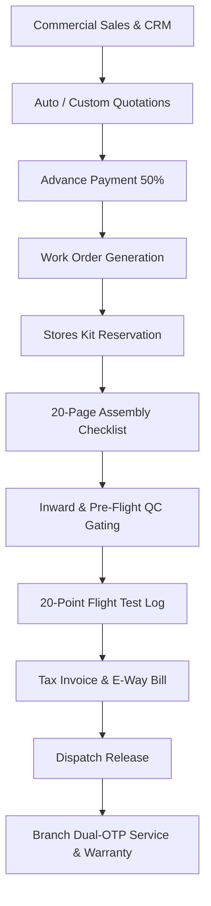
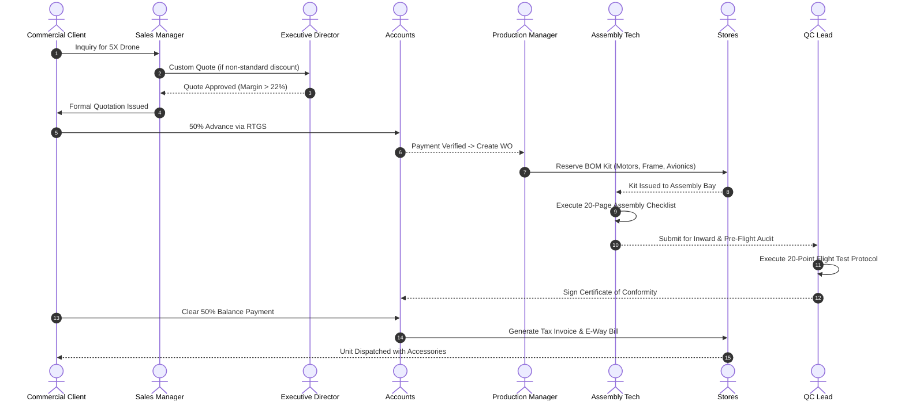

# GOAG Platform — Enterprise User & Operational Manual
**Document Code:** GOAG-DOC-MANUAL-2026-V1  
**System Target:** GOAG Platform Core Operating System (GOAG-OS)  
**Authoritative Source:** `GOAG_Platform_Business_Flow_Functional_Architecture_v1.0.pdf`  
**Classification:** Internal & External Partner Operational Guide  
**Release Date:** October 2026  
**Audience:** Internal Employees, Executive Directors, Assembly Technicians, Authorized Dealers, Commercial Clients  

---

## Table of Contents

1. [Executive Overview & System Architecture](#1-executive-overview--system-architecture)
2. [Security, RBAC & Privacy Invariants](#2-security-rbac--privacy-invariants)
3. [System Access, Login & Session Management](#3-system-access-login--session-management)
4. [Role-by-Role Operational Guides](#4-role-by-role-operational-guides)
   - [4.1 Master Administrator (Ganesh Pentela)](#41-master-administrator-ganesh-pentela)
   - [4.2 Executive Management & Directors](#42-executive-management--directors)
   - [4.3 Commercial Sales Department](#43-commercial-sales-department)
   - [4.4 Production Floor Management](#44-production-floor-management)
   - [4.5 Assembly Technicians & UAV Fab Engineers](#45-assembly-technicians--uav-fab-engineers)
   - [4.6 Quality Control (QC) & Flight Test Operations](#46-quality-control-qc--flight-test-operations)
   - [4.7 Stores, Inventory & Dispatch](#47-stores-inventory--dispatch)
   - [4.8 Procurement & Vendor Operations](#48-procurement--vendor-operations)
   - [4.9 Accounts, Invoicing & Financial Administration](#49-accounts-invoicing--financial-administration)
   - [4.10 Aftersales & Branch Service Operations](#410-aftersales--branch-service-operations)
   - [4.11 Human Resources & People Operations](#411-human-resources--people-operations)
   - [4.12 Research & Development (R&D) Sandbox](#412-research--development-rd-sandbox)
   - [4.13 Authorized Dealer Portal](#413-authorized-dealer-portal)
   - [4.14 Commercial Customer Portal](#414-commercial-customer-portal)
5. [Standard Operating Procedures (SOPs)](#5-standard-operating-procedures-sops)
   - [SOP-01: End-to-End Drone Manufacturing Lifecycle](#sop-01-end-to-end-drone-manufacturing-lifecycle)
   - [SOP-02: Dual-OTP Customer Service Handover Protocol](#sop-02-dual-otp-customer-service-handover-protocol)
   - [SOP-03: Custom Quotation & Director Margin Approval Gate](#sop-03-custom-quotation--director-margin-approval-gate)
   - [SOP-04: Dual-Sequence Invoicing (Cash vs. Bank) & GST Compliance](#sop-04-dual-sequence-invoicing-cash-vs-bank--gst-compliance)
6. [Automated Security Verification & Audit Console](#6-automated-security-verification--audit-console)
7. [Troubleshooting & Support Escalation Matrix](#7-troubleshooting--support-escalation-matrix)

---

## 1. Executive Overview & System Architecture

The **GOAG Platform** is the integrated Enterprise Operating System engineered specifically for **GOAG Services Pvt. Ltd.**, covering full-lifecycle agricultural and industrial unmanned aerial vehicle (UAV) manufacturing, commercial multi-tier distribution, shop-floor assembly gating, DGCA/ISO quality certification, dual-sequence accounting, and regional aftersales branches.



### Core Platform Capabilities
- **End-to-End Traceability:** Every manufactured drone unit (e.g., `GOAG-5X-001`) is tracked across its Bill of Materials (BOM), technician assembly history, flight telemetry log, serial numbers of motors/ESCs/flight controller, tax invoice, and field warranty tickets.
- **Strict Role-Based Access Control (RBAC):** Users access strictly role-tailored workspaces. A technician cannot see sales margins, an accounts officer cannot sign off on flight tests, and external dealers cannot see other dealers' orders.
- **Server-Enforced Data Privacy:** Financial boundaries (item prices, advance payments, outstanding balances, dealer discounts, margins) are redacted server-side before Work Order data is transmitted over the wire.
- **Multi-Tenant & Customer Isolation:** Authorized dealers operate within an isolated tenant portal (`OWN_DEALER`), and commercial customers operate within an isolated fleet portal (`OWN_ACCOUNT`).

---

## 2. Security, RBAC & Privacy Invariants

The GOAG Platform enforces access control at the server API layer via cryptographic Bearer session tokens. Frontend visibility is always derived from server-returned permissions.

### The Authorization Metamodel

$$\text{User} \longrightarrow \text{Session Token} \longrightarrow \text{Role} \longrightarrow \sum \Big( \text{Module} \times \text{Action} \times \text{Data Scope} \Big)$$

- **Supported Actions:** `VIEW`, `CREATE`, `EDIT`, `DELETE`, `APPROVE`, `MANAGE`
- **Supported Data Scopes:**
  - `ALL`: Unrestricted platform-wide visibility (Master Admin, Directors).
  - `OWN_DEPARTMENT`: Visibility scoped to records belonging to the user's operational team.
  - `ASSIGNED_RECORDS`: Records assigned directly to the individual employee identifier (e.g., technician's assigned work order).
  - `OWN_DEALER`: Tenant-isolated data partitioned by authorized dealer ID.
  - `OWN_ACCOUNT`: Customer-isolated data partitioned by commercial client ID.
  - `NONE`: Total denial of access.

### The Factory Floor Financial Privacy Boundary (Blueprint Section 7)
On the factory floor, assembly personnel must have complete visibility of technical engineering drawings, wiring diagrams, and BOM component specifications. However, **commercial terms must be strictly confidential**:
- **Technicians, Assemblers, Stores, and QC:** When calling `/api/work-orders`, the server automatically redacts `itemSellingPrice`, `advancePaymentReceived`, `outstandingBalance`, `discounts`, `margins`, and `commercialTerms`.
- **Wire Redaction:** The API response transmits `"financials": "[STRICTLY REDACTED AT SERVER LEVEL]"`. Even if a user opens browser DevTools or inspects raw HTTP traffic, no financial figures are present.

---

## 3. System Access, Login & Session Management

### 3.1 Accessing the Application
1. Open your web browser (Google Chrome, Microsoft Edge, Mozilla Firefox, or Safari).
2. Navigate to the platform URL:
   - **Local Development / Factory Intranet:** `http://localhost:8085/index.html` (or `http://127.0.0.1:8085/index.html`)
   - **Enterprise Production:** Configured corporate domain (e.g., `https://erp.goag.in/`).
3. You will be greeted by the **GOAG Secure Login Gateway**.

```
+--------------------------------------------------------------------------+
|                       GOAG PLATFORM ENTERPRISE OS                        |
|                     UAV Manufacturing & Supply Chain                     |
|                                                                          |
|  [Username / Employee ID]  : ___________________________                 |
|  [Password]               : ***************************                 |
|                                                                          |
|                 [ AUTHENTICATE & SECURE LOGIN ]                          |
+--------------------------------------------------------------------------+
```

### 3.2 Authentication & Session Flow
1. Enter your corporate **Username** or **Employee ID** and **Password**.
2. Click **Authenticate & Secure Login**.
3. Upon authentication:
   - The backend validates credentials and issues a cryptographic session token (`goag_sec_tok_...`).
   - The server resolves your assigned role, employee ID, and permission matrix.
   - The platform automatically routes you to your specific **Role Workspace Shell**.
   - Your sidebar navigation dynamically displays only the modules and tools you are permitted to use.
4. **Session Invalidation & Logout:**
   - To end your session securely, click the **Sign Out** button in the top right corner.
   - This immediately calls `/api/auth/logout`, revoking your session token on the server.

### 3.3 Development Test Credentials Reference
For development and training environments, the 14 standard test accounts are detailed in [TEST_LOGIN.md](file:///c:/Users/ganes/Music/goagerp/TEST_LOGIN.md).

---

## 4. Role-by-Role Operational Guides

---

### 4.1 Master Administrator (Ganesh Pentela)
- **Primary Persona:** Ganesh Pentela (`GOAG-A005`)
- **Assigned Workspace:** **Master Console**
- **Default Username:** `ganesh.admin`
- **Scope of Authority:** Global / Universal (`ALL`)

#### Core Responsibilities & Workflow:
1. **Master Data Governance (Section 2 & 3):**
   - Manage global company parameters, GST rates (18% electronics vs 5% agricultural UAVs), and tax configurations.
   - Only **Ganesh Pentela**, **Saran Kumar**, and **Maneesha** have authority to edit tax configurations and master company details.
2. **User & Employee Directory Management:**
   - Onboard new employees across all 23 official organization positions.
   - Assign roles, departmental affiliations, and base salaries.
3. **Comprehensive Audit Logs:**
   - Review platform-wide transaction histories, order status modifications, and security exceptions.
4. **HR & Payroll Administration:**
   - Approve final monthly payroll disbursements, employee leave adjustments, and salary slips.

---

### 4.2 Executive Management & Directors
- **Primary Personas:** 
  - Yalamarthi Tulasi Ram (`GOAG-A001`) — `director.test`
  - Bandaru Santhosh Kumar (`GOAG-A002`)
  - Battula Saran Kumar (`GOAG-A004`)
  - Vamsi Krishna K (`GOAG-A006`)
- **Assigned Workspace:** **Director Cockpit**
- **Scope of Authority:** Executive & Commercial Governance (`ALL`)

#### Core Responsibilities & Workflow:
1. **Executive KPI Cockpit:**
   - Monitor real-time enterprise metrics: Active Production Units, Monthly Revenue, Cash Book vs. Bank Balances, and Service SLA performance.
2. **Custom Quotation Margin Approval Gate (Section 6, Page 7):**
   - When Sales requests a non-standard discount exceeding standard thresholds, the quote is marked `PENDING_DIRECTOR_APPROVAL`.
   - The Director reviews the customer profile, proposed gross margin (minimum acceptable threshold is typically 22%), and clicks **Approve Quote** or **Reject / Request Adjustment**.
3. **Purchase Order (PO) Authorization (Section 15, Page 22):**
   - High-value vendor purchase orders for motors, carbon fiber tubes, batteries, and ground control systems require one Director's digital authorization before release.
4. **Delayed Payment Exception Approvals:**
   - Approve commercial terms where dispatch is authorized with a delayed payment promissory note rather than full 100% advance clearance.

---

### 4.3 Commercial Sales Department
- **Primary Persona:** Mandugula Vamshi Teja (`GOAG-E008`)
- **Assigned Workspace:** **Sales Workspace**
- **Default Username:** `sales.test`
- **Scope of Authority:** Leads, Quotes, Commercial Tracking (`OWN_DEPARTMENT`)

#### Core Responsibilities & Workflow:
1. **Lead Intake & Opportunity Tracking:**
   - Record incoming prospect details (Farmers, FPOs, Agri-enterprises, Spraying Contractors, Government Tenders).
   - Log customer GSTIN, delivery location, and target drone model (`GOAG 5X`, `GOAG 10X`, `GOAG Hexa-Heavy`).
2. **Quotation Generation (Auto-Quote vs. Custom Quote):**
   - **Auto-Quote:** Standard pricing with predefined catalog discounts. Generates an instant PDF quote with an automatic 14-day validity window.
   - **Custom Quote:** For custom payloads (multispectral cameras, dual smart battery kits, specialized nozzles). Requires setting commercial terms and routing to Director for margin sign-off.
3. **Confirming Advance Payment & Setting Commercial EDD:**
   - Once Accounts confirms receipt of the **50% Advance Payment**, Sales sets the **Estimated Delivery Date (EDD)** in agreement with Production.
   - Transition order status to `WON — WORK ORDER REQUESTED`.

---

### 4.4 Production Floor Management
- **Primary Persona:** Kapil Kumar K (`GOAG-E007`)
- **Assigned Workspace:** **Production Workspace**
- **Default Username:** `production.test`
- **Scope of Authority:** Manufacturing Operations (Financials Redacted)

#### Core Responsibilities & Workflow:
1. **Work Order Creation & Scheduling:**
   - Review pending sales handoffs and instantiate official **Work Orders** (e.g., `WO-2026-05X-014`).
   - Assign the work order to an assembly bay and designate a primary **Assembly Technician** (e.g., Bommali Himagiri).
2. **BOM Kit Issuance Request to Stores:**
   - Send the digital BOM reservation request to Stores for raw parts: Carbon fiber airframe, 4x T-Motor brushless propulsion systems, 4x ESCs, Cube Orange+ flight controller, Dual smart battery pack.
3. **Progress Oversight:**
   - Monitor live progress across the **20-Page Flight Assembly Checklist**.
   - Ensure the build stays on track to meet the commercial EDD.

---

### 4.5 Assembly Technicians & UAV Fab Engineers
- **Primary Personas:** 
  - Bommali Himagiri (`GOAG-E014`) — `technician.test`
  - Bommali Yuvaraju (`GOAG-E015`)
  - Ghanta Sasidhar (`GOAG-E016`)
  - Kaluva Palle Venkatesh (`GOAG-E017`)
  - Jagana Adhi Lakshmi (`GOAG-E018`)
- **Assigned Workspace:** **Technician Workspace (ESS)**
- **Scope of Authority:** Assigned Assembly Records & Checklists (`ASSIGNED_RECORDS`)

#### Core Responsibilities & Workflow:
1. **Accessing Assigned Work Orders:**
   - Log into the **Technician Workspace**. Navigate to **My Work Orders**.
   - View only the specific units assigned to you. Notice that commercial figures (margins, prices) are completely redacted.
2. **Executing the 20-Page Assembly Checklist:**
   - Click into the assigned checklist (e.g., `CL-5X-001-A`).
   - Work systematically through all sequential manufacturing phases:
     - *Phase 1:* Airframe unboxing, arm folding mechanism torque check (8.5 Nm).
     - *Phase 2:* Motor mount alignment and vibration damper installation.
     - *Phase 3:* ESC soldering, heat-shrink insulation, and power distribution board (PDB) polarity check.
     - *Phase 4:* Flight controller anti-vibration mounting, GPS mast positioning, telemetry transceiver binding.
     - *Phase 5:* Spraying subsystem assembly: 16L tank seating, brushless centrifugal pump mounting, quick-release spray nozzles, and flow sensor calibration.
3. **Recording Build Parameters:**
   - Record component serial numbers, wire resistance values, and motor rotation directions.
   - Click **Save Phase Sign-off**. Once all 20 phases are completed, submit the unit for **QC & Flight Testing Handoff**.
4. **Timesheet & ESS:**
   - Clock in and clock out of your daily shift in the **Timesheets & ESS** tab. Submit leave requests to HR.

---

### 4.6 Quality Control (QC) & Flight Test Operations
- **Primary Persona:** V Vishwateja Kumar Reddy (`GOAG-A003`)
- **Assigned Workspace:** **QC Workspace**
- **Default Username:** `qc.test`
- **Scope of Authority:** Inward Material Quality & Flight Test Sign-offs

#### Core Responsibilities & Workflow:
1. **Inward Raw Material Inspection (Section 10, Page 15):**
   - Inspect incoming component batches from vendors (motors, carbon tubes, LiPo batteries, nozzles).
   - Perform physical dimension checks, resistance testing, and record sample defect rates. Mark batch as `PASSED` or `QUARANTINED`.
2. **In-Process Assembly Audit:**
   - Inspect completed technician builds before the airframe shell is sealed. Verify solder joints, cable strain relief, and screw thread-locker application.
3. **Executing the 20-Point Flight Test Protocol (Section 14, Page 20):**
   - Move the assembled drone to the designated outdoor flight test facility.
   - Connect telemetry ground control station (GCS).
   - Conduct pre-flight sensor calibration: Accelerometer, Compass (Dual GPS), Barometer, Radar altimeter.
   - Execute flight testing:
     - 5-minute tethered hover test (vibration spectrum $< 15\,\text{m/s}^2$).
     - High-speed forward/reverse translation ($12\,\text{m/s}$).
     - Autonomous waypoint mission execution.
     - Spray pump pressure and nozzle distribution pattern verification.
     - Fail-safe verification: Transmitter signal loss $\rightarrow$ Return-to-Launch (RTL) trigger test.
     - Low-battery automatic landing test.
4. **Flight Log Sign-off & Ready for Dispatch Certificate:**
   - Log flight duration, peak current draw, motor surface temperatures ($< 65^\circ\text{C}$), and battery cell delta ($< 0.03\text{V}$).
   - Upload flight log (`.bin` or `.tlog`).
   - Sign off the **QC Certificate of Conformity** and mark unit as `READY_FOR_DISPATCH`.

---

### 4.7 Stores, Inventory & Dispatch
- **Primary Persona:** Guduri Harsha Deep (`GOAG-E011`)
- **Assigned Workspace:** **Stores Workspace**
- **Default Username:** `stores.test`
- **Scope of Authority:** Stock Movements, Inward/Outward, Packing (`OWN_DEPARTMENT`)

#### Core Responsibilities & Workflow:
1. **Goods Receipt Note (GRN) Inwarding:**
   - Receive raw materials from vendors accompanied by delivery challan.
   - Cross-reference with the open Purchase Order (PO). Inward stock into inventory bins.
2. **BOM Kit Reservation & Issuance:**
   - Upon receiving a Work Order kit request from Production, verify stock availability.
   - Physically pick the airframe, motors, ESCs, avionics, pump, and batteries. Commit stock in the system to prevent double-allocation.
3. **Reorder Level Monitoring:**
   - Monitor minimum stock thresholds (e.g., Propellers: min 50 sets; ESCs: min 20 units).
   - Trigger **Material Shortage Requisitions** to Procurement when inventory reaches reorder thresholds.
4. **Final Packing & Dispatch Verification:**
   - Receive the QC-passed drone. Assemble the commercial shipping kit: Flight battery charger, handheld remote controller, spare nozzle kit, user manual, DGCA UIN registration card.
   - Verify that Accounts has cleared the invoice and generated the **E-Way Bill**.
   - Affix shipping labels and hand over to freight carrier. Record dispatch tracking number.

---

### 4.8 Procurement & Vendor Operations
- **Primary Persona:** Bandaru Santhosh Kumar (`GOAG-A002`)
- **Assigned Workspace:** **Procurement Workspace**
- **Default Username:** `purchase.test`
- **Scope of Authority:** Vendor Negotiations & PO Creation (`OWN_DEPARTMENT`)

#### Core Responsibilities & Workflow:
1. **Material Requisition Intake:**
   - Review stock shortage alerts generated by Stores.
2. **Vendor RFQ & Price Negotiation:**
   - Request formal quotes from verified component suppliers (Propulsion, Carbon Composites, Avionics, Battery Packs).
   - Compare pricing, lead times, and warranty terms.
3. **Purchase Order (PO) Creation:**
   - Draft official PO in the system with vendor details, GST terms, and promised delivery dates.
   - Route POs exceeding standard value limits to **Tulasi Ram** or **Saran Kumar** for executive digital sign-off.
4. **Inbound Tracking & Delivery Follow-up:**
   - Track vendor shipments and coordinate with Stores for timely GRN inspection.

---

### 4.9 Accounts, Invoicing & Financial Administration
- **Primary Persona:** Uppalapati Maneesha (`GOAG-E012`)
- **Assigned Workspace:** **Accounts Workspace**
- **Default Username:** `accounts.test`
- **Scope of Authority:** Invoicing, Ledgers, Petty Cash, Tax Admin (`ALL`)

#### Core Responsibilities & Workflow:
1. **Dual-Sequence Tax Invoicing (Blueprint Section 17, Page 26):**
   - **Bank Sequence (`INV-BNK-2026-XXXX`):** For transactions settled via NEFT/RTGS/Cheque. Fully compliant with GST portal e-invoicing requirements.
   - **Cash Sequence (`INV-CSH-2026-XXXX`):** For counter sales and direct retail settlements within statutory cash transaction limits.
2. **Statutory GST Split Enforcement:**
   - **18% GST (HSN 8806 / SAC 9987):** Commercial industrial drones, training simulators, spare electronics, and maintenance service charges.
   - **5% Concessional GST (Notification 02/2022-CT):** Approved agricultural spraying drones sold to eligible farmers/FPOs with required declarations.
3. **E-Way Bill Generation:**
   - For all consignments with consignment value $> \text{INR } 50,000$, generate the mandatory E-Way bill prior to dispatch authorization.
4. **Petty Cash Book & Expense Voucher Workflow:**
   - Manage daily operational petty cash disbursements (factory consumables, courier charges, refreshments).
   - Every disbursement requires receipt attachment and supervisory approval before reimbursement.

---

### 4.10 Aftersales Support & Branch Operations
- **Primary Persona:** Meegala Vikas (`GOAG-E010`)
- **Assigned Workspace:** **Aftersales Workspace**
- **Default Username:** `aftersales.test`
- **Scope of Authority:** Branch Service, Defect Diagnostics, Dual-OTP Handover

#### Core Responsibilities & Workflow:
1. **Service Ticket Intake & Customer Check-in:**
   - When a drone is brought in for scheduled maintenance (50-hour / 100-hour service) or crash damage repair, create a **Service Ticket** (e.g., `SRV-2026-089`).
   - Record customer symptom description: Motor stutter, spray pump blockage, compass calibration failure, or structural arm crack.
2. **Dual-OTP Handover Protocol (Intake Phase):**
   - Generate an automated 6-digit **Intake OTP** sent to the registered customer's mobile number.
   - Enter the customer's OTP into the system to formally take custody of the aircraft.
3. **Diagnostic Inspection & Quotation:**
   - Inspect components and test on the bench.
   - Generate a Repair Estimate itemizing parts (e.g., 2x Propeller sets, 1x Arm boom) and labor charges.
4. **Warranty Fee Waiver Override Authority:**
   - If a failure is determined to be a manufacturing defect covered under the GOAG 1-Year Structural Warranty, **Meegala Vikas** possesses system authorization to mark spare part charges as `FEE_WAIVED (WARRANTY)`.
5. **Collection & Release (Delivery Phase):**
   - Perform post-service calibration and test flight.
   - Generate the **Delivery OTP** to the customer upon payment. Validate the OTP to complete aircraft release.

---

### 4.11 Human Resources & People Operations
- **Primary Persona:** Uppalapati Maneesha (`GOAG-E012`) / Ganesh Pentela (`GOAG-A005`)
- **Assigned Workspace:** **HR Workspace**
- **Default Username:** `hr.test`
- **Scope of Authority:** Attendance, Leave, Payroll, Staff Directory (`ALL`)

#### Core Responsibilities & Workflow:
1. **Daily Biometric Attendance Reconciliation:**
   - Monitor daily punch-in/punch-out records across factory assembly shifts and regional branch technicians.
   - Review late arrivals, overtime records, and regularizations.
2. **Leave Management:**
   - Review sick leave, casual leave, and earned leave requests submitted by staff via ESS. Route to respective departmental heads for approval.
3. **Monthly Payroll Processing:**
   - Compute monthly salary sheets taking into account basic pay, HRA, statutory deductions (PF, ESI, Professional Tax), and attendance deductions.
   - Submit the consolidated payroll sheet to **Ganesh Pentela** for final salary release authorization.

---

### 4.12 Research & Development (R&D) Sandbox
- **Primary Persona:** Voleti Veera Babu (`GOAG-E009`)
- **Assigned Workspace:** **R&D Sandbox**
- **Default Username:** `rnd.test`
- **Scope of Authority:** Isolated Prototypes & Experimental Telemetry

#### Core Responsibilities & Workflow:
1. **Air-Gapped Sandbox Environment:**
   - R&D operates in an isolated workspace to prevent experimental changes from impacting active production BOMs or commercial firmware.
2. **Prototype Versioning & CAD Repository:**
   - Manage prototype iterations (e.g., *GOAG 5X Mk II Hybrid*, *Payload Dropper v3*).
   - Log CAD design diffs, 3D printing iterations, and motor thermal stress test data.
3. **Prototype Graduation Gate:**
   - Once an experimental build passes 50 flight hours and environmental stress testing, R&D initiates a **Production Graduation Request** requiring joint sign-off from the R&D Lead and Executive Director.

---

### 4.13 Authorized Dealer Portal
- **Primary Persona:** Sri Balaji Drone Works (`DEALER-01`)
- **Assigned Workspace:** **Dealer Portal**
- **Default Username:** `dealer.test`
- **Scope of Authority:** Tenant-Isolated Dealer Orders & Spares (`OWN_DEALER`)

#### Core Responsibilities & Workflow:
1. **Tenant-Isolated View:**
   - Authorized dealers have strictly segregated access. You can only view your own dealership's data, approved distributor discount tiers, and customer leads.
2. **Bulk Drone & Spares Ordering:**
   - Browse the authorized dealer catalog.
   - Place bulk purchase orders for drones, spare arms, battery sets, and spray nozzles at contracted wholesale rates.
3. **Running Account Ledger & UTR Submission:**
   - Track outstanding credit limits, advance payments, and invoice histories.
   - Submit bank transaction UTR numbers for swift payment clearance and order release.
4. **Warranty & Service Claim Routing:**
   - Submit field warranty claims directly to Aftersales Lead Vikas Meegala with attached defect photos.

---

### 4.14 Commercial Customer Portal
- **Primary Persona:** Krishna Agri Enterprises (`CUST-8492`)
- **Assigned Workspace:** **Customer Portal**
- **Default Username:** `customer.test`
- **Scope of Authority:** Customer-Isolated Aircraft & Invoices (`OWN_ACCOUNT`)

#### Core Responsibilities & Workflow:
1. **Fleet Health Dashboard:**
   - View your registered GOAG drones (e.g., `GOAG-5X-001`), active warranty expiration dates, and cumulative flight hours.
2. **Digital Document Vault:**
   - Download GST Tax Invoices, DGCA Type Certificates, Pilot Operations Handbooks, and Maintenance Manuals.
3. **Service Booking & OTP Verification:**
   - Book on-site or branch service appointments.
   - View and confirm Dual-OTP verification codes during aircraft check-in and delivery.

---

## 5. Standard Operating Procedures (SOPs)

---

### SOP-01: End-to-End Drone Manufacturing Lifecycle



1. **Step 1 — Commercial Intake:** Sales enters customer details and selects drone configuration.
2. **Step 2 — Margin Approval:** If the quote requires custom pricing, Director verifies gross margin and signs off.
3. **Step 3 — Advance Clearance:** Customer deposits 50% advance. Accounts confirms transaction.
4. **Step 4 — Work Order Issuance:** Production creates Work Order and assigns it to a technician.
5. **Step 5 — BOM Reservation:** Stores allocates physical components from inventory.
6. **Step 6 — Assembly Execution:** Technician completes all 20 assembly checklist phases. Commercial data is hidden from the technician.
7. **Step 7 — QC & Flight Test:** QC Lead conducts sensor calibration and outdoor flight tests, uploading logs.
8. **Step 8 — Financial Settlement:** Customer clears remaining balance. Accounts generates Tax Invoice and E-Way bill.
9. **Step 9 — Dispatch:** Stores packs the unit with ground controller, chargers, and manuals, releasing the consignment.

---

### SOP-02: Dual-OTP Customer Service Handover Protocol

To eliminate disputes regarding custody, missing accessories, or unauthorized drone releases, regional service branches strictly follow the **Dual-OTP Protocol**:

```mermaid
flowchart LR
    A[Customer Arrives with Drone] --> B[Intake Inspection Recorded]
    B --> C[Generate INTAKE OTP via SMS]
    C --> D[Customer Provides OTP to Tech]
    D --> E[Aircraft Formally in Custody]
    E --> F[Diagnostics & Repair Execution]
    F --> G[Generate DELIVERY OTP]
    G --> H[Customer Verifies & Gives OTP]
    H --> I[Aircraft Formally Released]
```



1. **Intake Phase:**
   - Branch technician records intake physical condition (cracks, scratches, battery condition, propeller state).
   - Technician clicks **Generate Intake OTP**. An SMS is delivered to the customer's phone.
   - The customer relays the OTP to the technician, who submits it in the system. The repair ticket transitions to `IN_REPAIR`.
2. **Delivery Phase:**
   - Once repairs and test flights are completed, the customer settles the service invoice.
   - Technician clicks **Initiate Handover**. A distinct **Delivery OTP** is sent to the customer.
   - The customer verifies the flight demo and provides the Delivery OTP. The ticket transitions to `COMPLETED_HANDED_OVER`.

---

### SOP-03: Custom Quotation & Director Margin Approval Gate

1. **Threshold Trigger:** Any sales quote with a discount exceeding standard catalog tiers ($> 5\%$) or customized hardware payloads triggers the Director Approval Gate.
2. **Lock State:** The quote remains locked in `PENDING_DIRECTOR_APPROVAL` status. Sales cannot issue the quote to the client.
3. **Director Inspection:**
   - The Director views the breakdown: Total BOM Cost, Factory Overhead, Proposed Selling Price, and Projected Margin Percentage.
   - If the margin is acceptable, Director clicks **Authorize Quote**.
   - The quote unlocks, allowing Sales to export the finalized PDF to the customer.

---

### SOP-04: Dual-Sequence Invoicing (Cash vs. Bank) & GST Compliance

1. **Bank Settlement (`INV-BNK-`):**
   - Used for all corporate, dealer, and FPO transactions settled via electronic bank transfer.
   - Integrated with GST e-Invoicing portal (IRN and QR code generation).
2. **Cash Settlement (`INV-CSH-`):**
   - Strictly reserved for walk-in retail spare purchases and emergency field battery sales within legal cash transaction limits.
   - Numbered under an independent, non-overlapping sequence.
3. **GST Rate Application:**
   - Verify customer eligibility declarations before applying the concessional 5% agricultural rate. Commercial and industrial drones must be billed at standard 18% GST.

---

## 6. Automated Security Verification & Audit Console

The GOAG Platform includes a built-in, server-side security testing engine accessible at:
- **URL Route:** `http://localhost:8085/index.html#dev-rbac`
- **Direct API Endpoint:** `GET /api/dev/run-tests`

### Running the Security Test Suite:
1. Log into the platform with any authorized test user.
2. In the navigation sidebar, click **RBAC Test Matrix**.
3. Click the **Run 12 Automated RBAC Tests** button.
4. The system executes live HTTP requests against the backend server, validating:
   - Technician blocked from Accounts (`403 Forbidden`).
   - Technician Work Order response has financial fields stripped.
   - Technician blocked from editing other technicians' checklists (`403 Forbidden`).
   - Sales blocked from HR payroll records (`403 Forbidden`).
   - Accounts blocked from modifying production assembly checklists (`403 Forbidden`).
   - Dealer tenant isolation strictly enforced.
   - Customer fleet isolation strictly enforced.
   - Non-admins blocked from Master Data administration.
   - Master Admin universal access verified.
   - Token revocation verified on logout.
   - Unauthenticated API access blocked (`401 Unauthorized`).
   - Direct raw API calls validated.
5. All 12 test rows will display a green **PASS** badge. Full technical logs are recorded in [RBAC_TEST_RESULTS.md](file:///c:/Users/ganes/Music/goagerp/RBAC_TEST_RESULTS.md).

---

## 7. Troubleshooting & Support Escalation Matrix

### 7.1 Common Issues & Resolutions

| Issue / Error | Probable Cause | Corrective Action |
| :--- | :--- | :--- |
| **HTTP 401 Unauthorized** | Session expired or Bearer token missing. | Click **Sign Out**, navigate to `#login`, and log in again. |
| **HTTP 403 Forbidden** | Attempted to access a module outside your role permissions. | Verify your assigned role in the top-right profile badge. If you need elevated access, contact Ganesh Pentela. |
| **Work Order Financials Blank / Missing** | Role is designated as Technical (Technician, QC, Stores). | Expected security behavior. Financial fields are strictly redacted at the server level for shop-floor roles. |
| **Cannot see other dealer's orders** | Tenant isolation active. | Expected behavior. Dealers can only view their own dealership's transactions. |
| **OTP SMS Not Received by Customer** | Customer phone number incorrect or network delay. | In Aftersales workspace, verify customer phone number and click **Resend OTP** (allowed once every 60 seconds). |

### 7.2 Enterprise Support & Escalation Directory

For administrative assistance, role reassignments, or system exceptions:

| Department / Role | Contact Person | Official Email | Escalation Responsibility |
| :--- | :--- | :--- | :--- |
| **Master Admin & HR Operations** | **Ganesh Pentela** | `ganesh.pentela@goag.in` | Global system access, Master Data, Executive escalations |
| **Executive Management** | **Yalamarthi Tulasi Ram** | `tulasi.ram@goag.in` | Commercial quotes, delayed payments, PO approvals |
| **Finance & Accounts** | **Battula Saran Kumar** | `saran.kumar@goag.in` | Tax configuration, banking ledgers, statutory audits |
| **Quality Control & Procurement** | **V Vishwateja Kumar Reddy** | `vishwateja@goag.in` | QC standards, DGCA flight compliance, vendor quality |
| **Production Operations** | **Kapil Kumar K** | `kapil.kumar@goag.in` | Work order scheduling, technician task allocation |
| **Aftersales & Branch Network** | **Meegala Vikas** | `vikas.meegala@goag.in` | Regional service centers, warranty waivers, dual-OTP issues |
| **Technical Support / IT Helpdesk** | **Antigravity Systems Team** | `support@goag.in` | Server uptime, API connectivity, token resolution |

---
*GOAG Platform Operational Manual &bull; Confidential & Proprietary &bull; GOAG Services Pvt. Ltd.*
