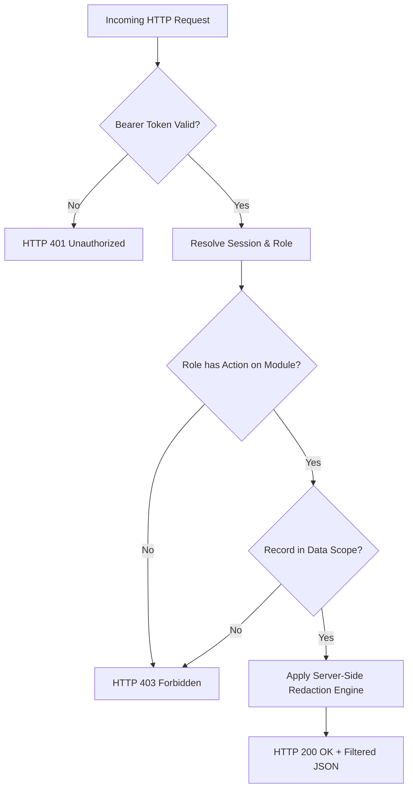

# GOAG Platform — Centralized RBAC & Security Architecture Specification
**Document Code:** GOAG-ARCH-RBAC-2026-V1  
**Target Platform:** GOAG Platform Core Operating System  
**Authoritative Source:** `GOAG_Platform_Business_Flow_Functional_Architecture_v1.0.pdf` (Sections 2, 3, 4, 6, 7, 10, 14, 15, 17, 26, 31, 32, 34)

---

## 1. Centralized Authorization Metamodel

The GOAG Platform enforces security through an immutable, multi-dimensional permission model:

$$\text{User} \longrightarrow \text{Session Token} \longrightarrow \text{Role} \longrightarrow \sum \Big( \text{Module} \times \text{Action} \times \text{Data Scope} \Big)$$



### Supported Actions
- **`VIEW`**: Read-only query capability.
- **`CREATE`**: Ability to instantiate a new transaction record.
- **`EDIT`**: Ability to modify mutable operational parameters.
- **`DELETE`**: Ability to archive or purge uncommitted draft records.
- **`APPROVE`**: Managerial or executive authorization gate sign-off.
- **`MANAGE`**: Full administrative lifecycle manipulation.

### Supported Data Scopes
- **`ALL`**: System-wide global visibility across all departments and records.
- **`OWN_DEPARTMENT`**: Records originating within or assigned to the user's specific operational department.
- **`ASSIGNED_RECORDS`**: Records strictly assigned to the specific employee identifier (e.g. technician's assigned work order).
- **`OWN_DEALER`**: Records partitioned by authorized dealer tenant ID.
- **`OWN_ACCOUNT`**: Records partitioned by commercial customer ID.
- **`NONE`**: Absolute denial of access.

---

## 2. Definitive Role-Based Access Control (RBAC) Matrix

| Role Identifier | Primary Shell / Workspace | Modules with `VIEW` | Modules with `CREATE`/`EDIT` | Modules with `APPROVE`/`MANAGE` | Work Order Financial Scope |
| :--- | :--- | :--- | :--- | :--- | :--- |
| **`MASTER_ADMIN`** | **Master Console** | ALL | ALL | ALL | **UNRESTRICTED (Full)** |
| **`DIRECTOR`** | **Director Cockpit** | Cockpit, Sales, Prod, QC, Stores, Invoicing, Map | Custom Quotes, POs | Custom Quotes, Delayed Pay, POs | **UNRESTRICTED (Full)** |
| **`SALES`** | **Sales Workspace** | Sales, Quotes, Production Status, Map | Leads, Quotes (Auto/Custom) | None (Director sign-off required) | **COMMERCIAL ONLY** |
| **`PRODUCTION_MANAGER`**| **Production Workspace**| Production, Checklist, Stores (Stock Only)| Task Assignment, Timesheets | Assembly Handoff | 🚫 **STRICTLY REDACTED** |
| **`ASSEMBLY_TECHNICIAN`**| **Technician Workspace**| Assigned WO, 20-Page Checklist, ESS | Checklist Form Parameters, Timesheet| Self-Inspection Sign-off | 🚫 **STRICTLY REDACTED** |
| **`QC`** | **QC Workspace** | Production, Checklist, Flight Logs, QC Vault | Inward QC, Flight Log, Audit Photos | Flight Sign-off, Ready to Dispatch | 🚫 **STRICTLY REDACTED** |
| **`STORES`** | **Stores Workspace** | Stores, Inventory, BOM Checks, Dispatch | Inward Logs, Material Requests, Shipping | Stock Commitment, Dispatch Release| 🚫 **STRICTLY REDACTED** |
| **`PROCUREMENT`** | **Procurement Workspace**| Stores Shortages, Material Requests, Vendors | Vendor Quotes, PO Creation | PO Authorization (Director) | **VENDOR COSTS ONLY** |
| **`ACCOUNTS`** | **Accounts Workspace** | Invoices, Cash Book, Bank Ledger, Petty Cash | Tax Invoices, E-Way Bills, Vouchers | Payment Clearance, Cash/Bank Seq | **UNRESTRICTED (Full)** |
| **`AFTERSALES`** | **Aftersales Workspace**| Support Calls, Service Cases, Defect Analytics| Case Intake (OTP), Diagnostics, Spares | Warranty Fee Waiver Override (Vikas)| 🚫 **STRICTLY REDACTED** |
| **`HR`** | **HR Workspace** | Attendance, Employee Profiles, Salary Sheets | Daily Attendance, Claims Verification | Monthly Salary Override, Offer Docs| 🚫 **STRICTLY REDACTED** |
| **`R_AND_D`** | **R&D Sandbox** | R&D Sandbox, CAD Vault, Prototype Logs | Test Iterations, Sensor Logs, CAD Diffs| Prototype Graduation (Joint Dir) | 🚫 **COMMERCIAL REDACTED**|
| **`DEALER`** | **Dealer Portal** | Own Orders, Dealer Spares Catalog, Own Ledger | Bulk Orders, UTR Payment Logs | Service Tickets to Vikas | **OWN DEALER PRICING ONLY** |
| **`CUSTOMER`** | **Customer Portal** | Own Fleet, Invoices, Warranties, Live Service | Live Service Inquiries, OTP Handover | None | **OWN INVOICE VALUE ONLY**|

---

## 3. Work Order Financial Data Redaction Engine (Section 7 Mandate)

When a client queries `/api/work-orders` or `/api/work-orders/:id`:

```json
{
  "id": "WO-2026-05X-014",
  "unitSerial": "GOAG-5X-001",
  "customerName": "Krishna Agri Enterprises",
  "bomSpec": "Standard 5X Quad Rigs + Dual Smart Battery",
  "commercialEdd": "18-Oct-2026",
  "assignedTechnicianId": "GOAG-E014",
  "checklistProgress": 14,
  "financials": {
    "itemSellingPrice": 485000,
    "advancePaymentReceived": 300000,
    "outstandingBalance": 272300,
    "discounts": 0,
    "margins": 112000,
    "commercialTerms": "50% Advance, Balance on dispatch"
  }
}
```

### Server Enforcement Rule:
If `session.role` is `ASSEMBLY_TECHNICIAN`, `PRODUCTION_MANAGER`, `QC`, or `STORES`:
1. The `financials` key is deleted from the record object before JSON serialization:
   ```powershell
   $redactedWO.PSObject.Properties.Remove('financials')
   ```
2. The payload delivered across the HTTP transport does NOT contain any price, cost, discount, advance, or margin fields.
3. No browser DevTools inspection or network sniff can expose commercial figures.

---

## 4. Multi-Tenant & Multi-Customer Isolation Engine

### Dealer Tenant Isolation (Section 31 & 32):
- Any request from a `DEALER` session is bound to `session.tenantId`.
- The SQL/object query automatically appends `WHERE tenantId = session.tenantId`.
- Attempting to pass another dealer's ID returns `HTTP 403 Forbidden`.

### Customer Fleet Isolation (Section 8 & 32):
- Any request from a `CUSTOMER` session is bound to `session.customerId`.
- Returns only aircraft records where `customer_id == session.customerId`.
- Attempting to access another customer's drone returns `HTTP 403 Forbidden`.
