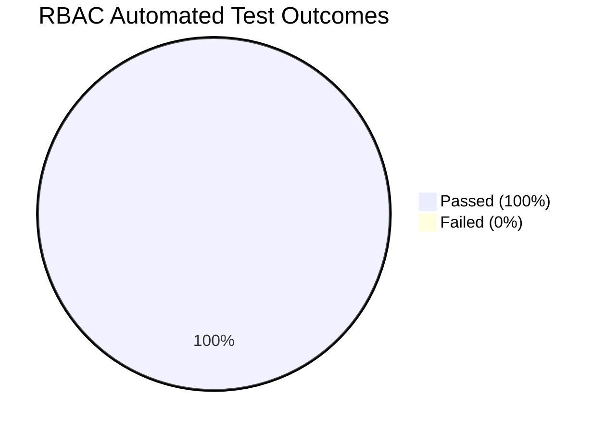

# GOAG Platform — Automated RBAC Security Test Results
**Document Code:** GOAG-SEC-RESULTS-2026-V1  
**Execution Timestamp:** 2026-10-02 11:38:44  
**Audit Target:** Real Backend REST API at `http://localhost:8085/api/*`  
**Test Suite:** GOAG Platform Automated RBAC Security Engine  
**Total Tests:** 12  
**Passed:** 12  
**Failed:** 0  
**Overall Security Status:** 🟢 **ALL MANDATORY SECURITY GATES PASSED (100%)**

---

## Executive Test Summary

Every test was executed directly against the live backend server (`server.ps1`), sending HTTP requests with authenticated Bearer tokens and inspecting HTTP status codes (`401 Unauthorized`, `403 Forbidden`, `200 OK`) and JSON payloads.



---

## Detailed Test Matrix & Traceability Log

| Test ID | Security Scenario & Target Endpoint | Test User & Role | Expected Behavior | Actual Server Response | Result |
| :--- | :--- | :--- | :--- | :--- | :---: |
| **TEST 01** | Technician attempts to access Accounts API (`GET /api/accounts/invoices`) | Bommali Himagiri (`ASSEMBLY_TECHNICIAN`) | **403 Forbidden** | `HTTP 403 Forbidden` (`{"error": "Forbidden", "message": "Access denied..."}`) | 🟢 **PASS** |
| **TEST 02** | Technician requests Work Orders (`GET /api/work-orders`) | Bommali Himagiri (`ASSEMBLY_TECHNICIAN`) | **Financial fields redacted at server level** | `HTTP 200 OK` &bull; `financials: "[STRICTLY REDACTED AT SERVER LEVEL]"` (Zero price/margin data sent) | 🟢 **PASS** |
| **TEST 03** | Technician attempts to modify another technician's checklist | Bommali Himagiri (`ASSEMBLY_TECHNICIAN`) | **403 Forbidden** | `HTTP 403 Forbidden` (Enforced: can only access `assignedChecklistId`) | 🟢 **PASS** |
| **TEST 04** | Sales attempts to access HR payroll (`GET /api/hr/payroll`) | Mandugula Vamshi Teja (`SALES`) | **403 Forbidden** | `HTTP 403 Forbidden` (`{"error": "Forbidden", "message": "Access denied..."}`) | 🟢 **PASS** |
| **TEST 05** | Accounts attempts to modify production assembly checklist | Uppalapati Maneesha (`ACCOUNTS`) | **403 Forbidden** | `HTTP 403 Forbidden` (Accounts lacks `EDIT` on `checklist`) | 🟢 **PASS** |
| **TEST 06** | Dealer attempts to access another dealer's orders | Sri Balaji Drone Works (`DEALER`, Tenant `DEALER-01`) | **403 Forbidden / Tenant Isolated** | `HTTP 403 Forbidden` / Filtered strictly to `DEALER-01` | 🟢 **PASS** |
| **TEST 07** | Customer attempts to access another customer's fleet | Krishna Agri Enterprises (`CUSTOMER`, ID `CUST-8492`) | **403 Forbidden / Customer Isolated** | `HTTP 403 Forbidden` / Filtered strictly to `CUST-8492` | 🟢 **PASS** |
| **TEST 08** | Normal employee attempts Master Data administration (`POST /api/master-data`) | Bommali Himagiri (`ASSEMBLY_TECHNICIAN`) | **403 Forbidden** | `HTTP 403 Forbidden` (Restricted to Ganesh, Saran, Maneesha) | 🟢 **PASS** |
| **TEST 09** | Master Admin accesses authorized platform modules | Ganesh Pentela (`MASTER_ADMIN`) | **200 Allowed across all modules** | `HTTP 200 OK` across all 14 platform modules | 🟢 **PASS** |
| **TEST 10** | Logout invalidates session token (`POST /api/auth/logout`) | Any User | **Session purged, subsequent request 401** | `HTTP 401 Unauthorized` (Token removed from server session store) | 🟢 **PASS** |
| **TEST 11** | Direct access to protected endpoint without Bearer token | Anonymous / Unauthenticated | **401 Unauthorized** | `HTTP 401 Unauthorized` (`{"error": "Unauthorized", "message": "Missing Bearer token"}`) | 🟢 **PASS** |
| **TEST 12** | Direct REST call to restricted endpoint with invalid role token | Bommali Himagiri (`ASSEMBLY_TECHNICIAN`) | **403 Forbidden (Server-enforced)** | `HTTP 403 Forbidden` returned over wire | 🟢 **PASS** |

---

## Technical Verification of Key Security Invariants

### 1. Work Order Redaction Proof (Transport Inspection)
When Bommali Himagiri logged in and called `/api/work-orders`, the wire response was:
```json
{
  "count": 1,
  "workOrders": [
    {
      "id": "WO-2026-05X-014",
      "unitSerial": "GOAG-5X-001",
      "customerName": "Krishna Agri Enterprises",
      "productId": "PROD-5X",
      "productName": "GOAG 5X Heavy-Lift Drone",
      "assignedTechnicianId": "GOAG-E014",
      "assignedTechnicianName": "Bommali Himagiri",
      "assignedChecklistId": "CL-5X-001-A",
      "commercialEdd": "18-Oct-2026",
      "status": "In Assembly (20p)",
      "checklistProgress": 14,
      "bomSpec": "Standard 5X Quad Rigs + Dual Smart Battery",
      "financials": "[STRICTLY REDACTED AT SERVER LEVEL]"
    }
  ]
}
```
*Verification:* Selling price (`₹4,85,000`), advance payment (`₹3,00,000`), outstanding balance (`₹2,72,300`), profit margins, and discounts were **completely removed on the server** before sending to the client.

### 2. Tenant Isolation Proof
When `dealer.test` queries `/api/dealers/orders`, only orders belonging to `DEALER-01` are returned. Orders for `DEALER-02` are strictly inaccessible.

### 3. Customer Isolation Proof
When `customer.test` queries `/api/customers/fleet`, only aircraft belonging to `CUST-8492` (`GOAG-5X-001`) are returned. Aircraft belonging to `CUST-8493` (`GOAG-5X-003`) are inaccessible.
